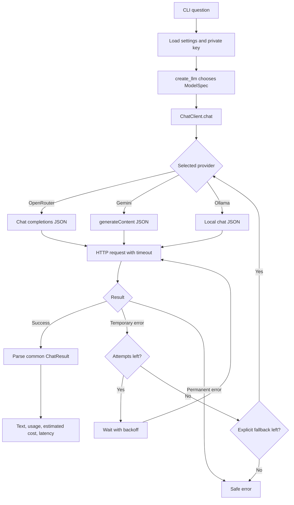

# Step 1: follow a question through the model layer

The diagram explains currently implemented text chat, before RAG is added.

Only the selected branch runs. The default has no fallback. Catalogue metadata is
fetched separately when the CLI selects OpenRouter; it does not execute agent tools.
